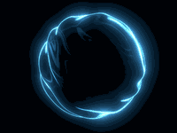
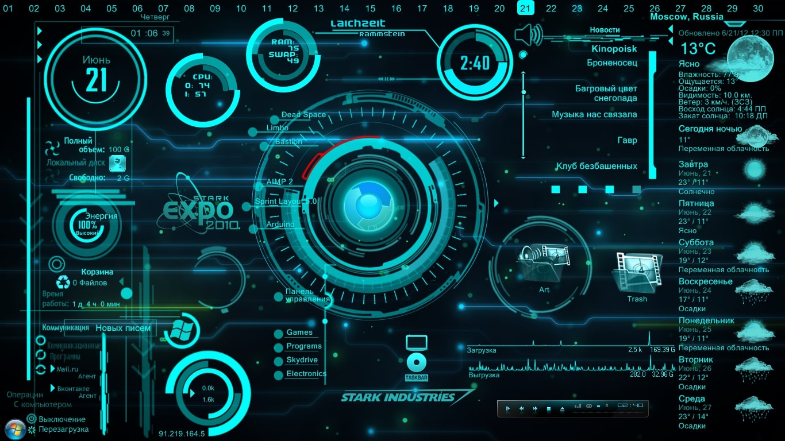

<div align="center">

# NaxionAI Powered by Neuroworks



**NaxionAI Powered by Neuroworks** — inspired by Mr Magaya and JARVIS.

</div>

## NeuroWorks Shell

An **empty-state, UAT-ready** package of the NeuroWorks platform. Full
functionality, **none of the operator's data** — no users, no connectors, no
knowledge vault, no company personas, no API keys. Hand this to a tester and
they stand up their own clean instance.

It contains two systems that can run independently or together:

- **`neuroworks-ts/`** — the TypeScript build (Express API + React SPA), one
  port, `http://localhost:7471`.
- **`digital-force-py/`** — the Python build (FastAPI backend + Next.js
  frontend + Qdrant + Postgres), `http://localhost:8000` / `:3000`.

<p align="center">
 
  <br/>
  <sub>Voice-assistant lineage — see <a href="#-inspiration">Inspiration</a> below. The live mic-listening
  indicator in the app itself (<code>VoiceDiscussion</code>) is a few CSS-animated bars, not a video asset —
  see <code>MicWaveform</code> in <code>neuroworks-ts/web/src/components/VoiceDiscussion.tsx</code>.</sub>
</p>

## Start here

Read **[AI-STARTUP.md](AI-STARTUP.md)** — a step-by-step, copy-pasteable startup
runbook designed so an **AI assistant or a human** can bring the stack up from
zero. The short version:

```bash
cp neuroworks-ts/.env.example    neuroworks-ts/.env
cp digital-force-py/.env.example digital-force-py/.env
# set JWT_SECRET_KEY + ENCRYPTION_KEY in digital-force-py/.env (see AI-STARTUP.md §2.2)
docker compose up --build
```

Then open the app and **create the first account** — it becomes the workspace
**owner (superadmin)**. That is the entire onboarding.

## What "shell" means here

| Stripped out                                  | Kept (functionality)                                  |
|-----------------------------------------------|-------------------------------------------------------|
| All users (seeded owner removed)              | Full auth + first-run owner bootstrap                 |
| Connectors, integrations, API keys            | The connector/integration framework (add your own)    |
| Knowledge vault / "second brain" content      | Vault engine (points at a local empty `./vault`)      |
| Company personas, datasets, job history       | The built-in generic skills + persona engine          |
| Every real secret (`.env`, tokens, DB dumps)  | `.env.example` templates                              |

No `.git` history is included (so no embedded tokens travel with the bundle).

## 🎬 Inspiration

The look and feel here nods to the "build your own JARVIS" lineage of
open-source voice assistants — a single-user, single-machine loop that
listens, thinks, and talks. NeuroWorks Shell takes that same premise (an AI
that acts on your behalf) and scales it into a multi-agent workforce with
memory, governance, and network reach. The Stark-HUD banner and mascot above
are reference assets from that lineage, not screenshots of this app.

## License

See `neuroworks/LICENSE`.

<br>

